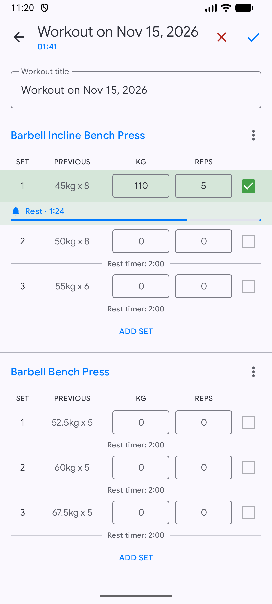
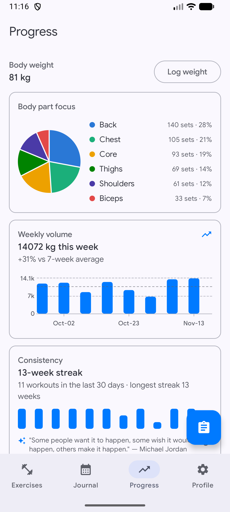
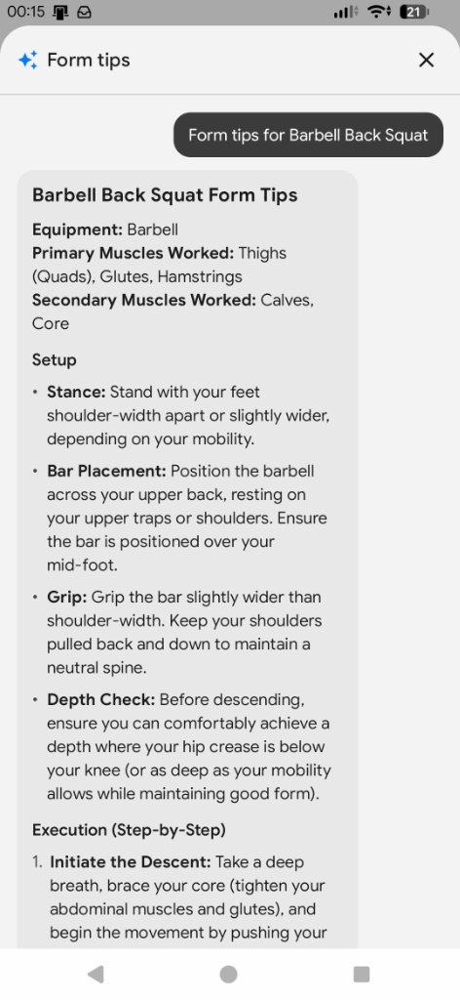

# Train Free

A local-first, 100% offline gym workout logger for **iOS** and **Android**. No account, no sign-in, no backend, and no subscriptions — all workout logs, routines, and body metrics stay in an on-device SQLite database.

<p>
  <a href="https://play.google.com/store/apps/details?id=dev.balaji.moonrose.trainfree">
    
  </a>
</p>

> **iOS:** Not on the App Store yet — it can be built and run locally from source.

<table>
  <tr>
    <td align="center">
      <br />
      <sub><strong>Live Workout</strong></sub>
    </td>
    <td align="center">
      <br />
      <sub><strong>Progress &amp; Metrics</strong></sub>
    </td>
    <td align="center">
      <br />
      <sub><strong>On-device form tips</strong></sub>
    </td>
  </tr>
</table>

## What's inside

- **Fast workout logging:** Start an empty workout or launch a routine, log weight/reps/RPE with previous-set references, and use the built-in rest timer.
- **Programs & exercise catalog:** Seeded reference exercise library with muscle/equipment filters, custom exercises, and reusable multi-day programs/routines.
- **Progress & analytics:** Deterministic 1RM estimates (Epley, Brzycki, Lombardi, O'Conner), volume trends, muscle focus breakdown, streaks, and body metrics tracking.
- **Calendar & workout journal:** Monthly training calendar with per-day workout history and a Markdown workout journal.
- **On-device AI (optional):** Uses **Apple Intelligence** (`FoundationModels`) on iOS and **Gemini Nano** (ML Kit GenAI) on Android for exercise form tips and progress narration when supported by the device.
- **Local ownership:** No `INTERNET` permission; supports Health Connect (Android) and JSON backup export/import.

## Tech stack

| Layer | Technology |
| --- | --- |
| **Shared logic & state** | Kotlin Multiplatform (`2.4.0`), `kotlinx-coroutines` (`StateFlow`), `kotlinx-datetime`, `kotlinx-serialization`, SKIE (exposes `StateFlow` to Swift as `AsyncSequence`) |
| **Local database** | Room KMP (`2.8.4`) + bundled SQLite (`2.6.2`) via KSP |
| **Android UI** | Jetpack Compose (Compose Multiplatform `1.11.1`), Material 3 Expressive (`1.11.0-alpha07`), Vico charts, Health Connect, ML Kit GenAI |
| **iOS UI** | Native SwiftUI (iOS 26.0+ / Liquid Glass), `FoundationModels` |

### Project structure

- `sharedLogic/` — Platform-agnostic domain models (`commonMain`), Room database, repositories, and `StateFlow`-based form/screen state holders (`dbMain`, shared by Android and iOS).
- `sharedUI/` — Android Compose UI screens and resources; also acts as the umbrella module that packages the `SharedUI` XCFramework for iOS.
- `androidApp/` — Android application entry point (`dev.balaji.moonrose.trainfree`, minSdk 26, targetSdk 36).
- `iosApp/` — Native SwiftUI Xcode project consuming `SharedUI` (`sharedLogic` state and repositories).

## Running locally for testing

### Prerequisites

- **JDK 11+** (ensure `JAVA_HOME` points to a valid JDK)
- **Android:** Android Studio or Android SDK (API 36) + an emulator or USB-debugging device
- **iOS:** macOS with **Xcode 26+** (deployment target is iOS 26.0)

### Android

Build a debug APK:

```bash
./gradlew :androidApp:assembleDebug
```

Install and launch on a connected device or running emulator:

```bash
./gradlew :androidApp:installDebug
```

Or open the repository root in Android Studio and run the `androidApp` configuration.

### iOS

Open `iosApp/iosApp.xcodeproj` in Xcode and run the `iosApp` scheme on an iOS 26+ simulator or device.

To build from the command line:

```bash
xcodebuild -project iosApp/iosApp.xcodeproj -scheme iosApp -destination 'generic/platform=iOS Simulator' build
```

> If `xcodebuild`'s **Compile Kotlin Framework** phase fails with a toolchain error, export `JAVA_HOME` explicitly before running `xcodebuild`, and set `DEVELOPER_DIR=/Applications/Xcode.app/Contents/Developer` if `xcode-select` points to Command Line Tools.

### Running tests

Run the unit and migration tests for the platform you're working on:

```bash
# Android host tests
./gradlew :sharedUI:testAndroidHostTest :sharedLogic:testAndroidHostTest

# iOS simulator tests (macOS)
./gradlew :sharedUI:iosSimulatorArm64Test :sharedLogic:iosSimulatorArm64Test
```

### Resetting app state

On first launch, the app shows a local profile setup gate. To wipe local data and return to a fresh install:

- **Android:** `adb shell pm clear dev.balaji.moonrose.trainfree`
- **iOS Simulator:** Delete the app from the simulator (the SQLite database is stored in the app's Documents directory).

## Architecture & contributing

Detailed architecture notes, database migration guidelines, and localization conventions are documented in [AGENTS.md](AGENTS.md).

---

Built with Kotlin Multiplatform, SwiftUI, and Jetpack Compose · [trainfree.balaji.dev](https://trainfree.balaji.dev) · [GitHub](https://github.com/balaji/TrainFree) · [balaji.dev](https://www.balaji.dev) · [Privacy Policy](https://trainfree.balaji.dev/privacy)
